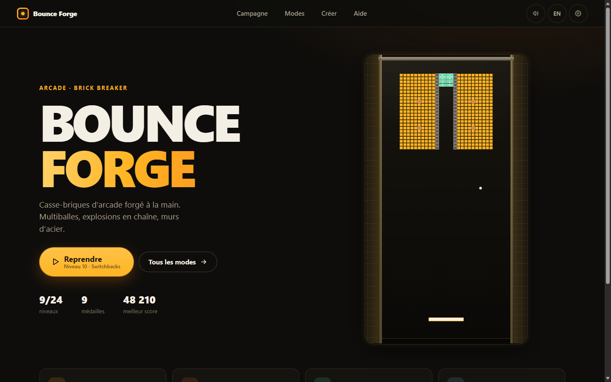
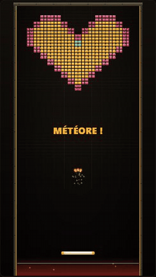
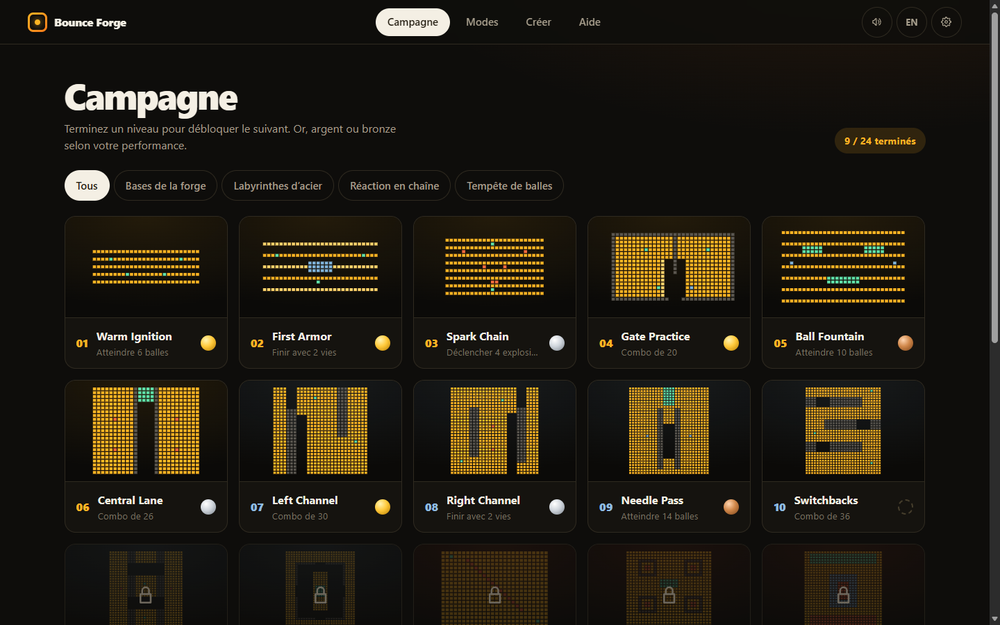
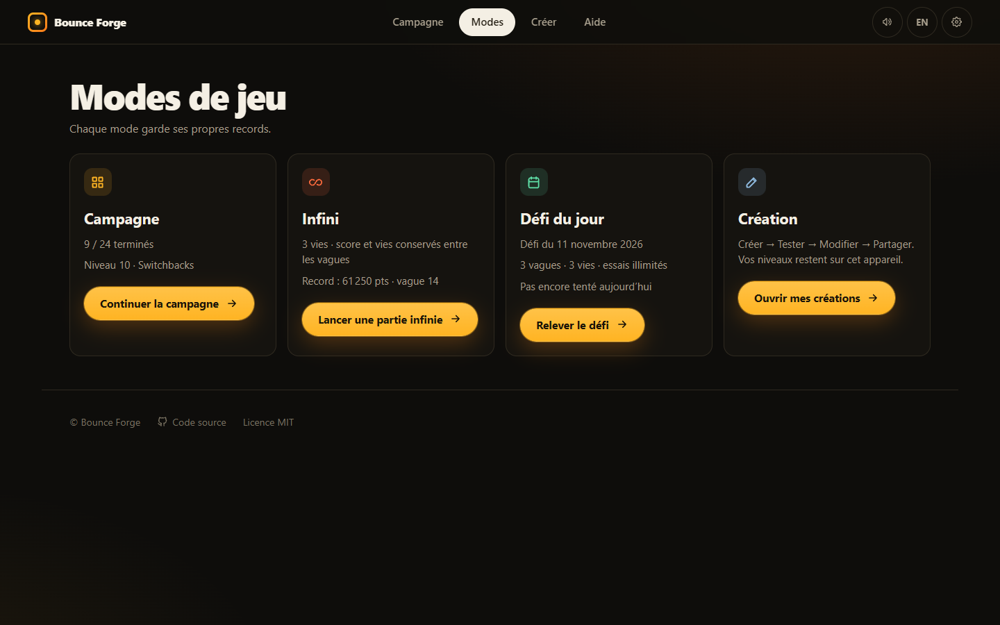

<p align="center">
  
</p>

<h1 align="center">Bounce Forge</h1>

<p align="center">
  <strong>A hand-forged arcade brick breaker.</strong><br />
  Multiballs, chain explosions, steel walls — on desktop and mobile.
</p>

<p align="center">
  <a href="https://matteo12sa.github.io/bounce-forge/"><strong>▶ Play now</strong></a>
  ·
  <a href="README.md">Français</a>
  ·
  <a href="CHANGELOG.md">Changelog</a>
</p>

<p align="center">
  
</p>

## The game

Bounce Forge is an original brick breaker that runs in the browser — no install, no account. One
ball becomes three, then ten, then forty: every level is built around one idea — precise aiming,
chain reactions, or flooding the field with balls.

| Campaign                                                                     | Modes                                                                              |
| ---------------------------------------------------------------------------- | ---------------------------------------------------------------------------------- |
|  |  |

## Features

- **24-level campaign** in 4 chapters with a gold, silver or bronze medal on every level.
- **Endless mode**: never-ending waves, three lives, score and lives carried between waves.
  Difficulty caps at the last campaign tier.
- **Daily challenge**: three waves, identical for everyone, seeded from the UTC date. Unlimited
  attempts, best score kept.
- **Level editor**: draw, test, edit, then share your level with a `BF2:` code (accents and emoji
  included).
- **Six brick kinds** recognisable by colour _and_ outline: standard, reinforced, explosive,
  bonus, shield, indestructible steel.
- **Built for every screen**: side HUD on desktop, compact HUD and touch controls on mobile,
  44 px minimum targets.
- **Accessible**: keyboard navigation, visible focus, a “Reduce motion” option, French and
  English.
- **Local save** for progress, medals, records and creations (nothing is sent anywhere).

## Controls

| Action          | Desktop                        | Mobile           |
| --------------- | ------------------------------ | ---------------- |
| Move the paddle | Mouse, `←` `→` or `A` `D`      | Drag your finger |
| Launch the ball | Click, `Space` or `Enter`      | Tap the screen   |
| Pause           | `Esc`, `P` or the pause button | Pause button     |
| Restart         | `R`                            | Pause menu       |

## Quick start

Requires [Node.js](https://nodejs.org/) 20 or newer (CI uses Node 24).

```bash
git clone https://github.com/MATTEO12SA/bounce-forge.git
cd bounce-forge
npm ci
npm run dev
```

Open <http://localhost:5173>. `npm run dev` also starts the small local admin server used to edit
the official levels (see [SECURITY.md](SECURITY.md)). Game only: `npm run dev:vite`.

| Command                          | Purpose                                                  |
| -------------------------------- | -------------------------------------------------------- |
| `npm run lint`                   | ESLint                                                   |
| `npm test`                       | Unit tests (Vitest)                                      |
| `npm run build`                  | TypeScript check and production build in `dist/`         |
| `npm run test:smoke`             | Full journey in a real headless browser (after `build`)  |
| `node scripts/capture-media.mjs` | Regenerates the screenshots and animation of this README |

## Contributing

Ideas, bug reports and levels are welcome: read [CONTRIBUTING.md](CONTRIBUTING.md), then open an
[issue](https://github.com/MATTEO12SA/bounce-forge/issues/new/choose).

## Credits and license

Code under the [MIT](LICENSE) license. Third-party libraries and assets are listed in
[CREDITS.md](CREDITS.md).
