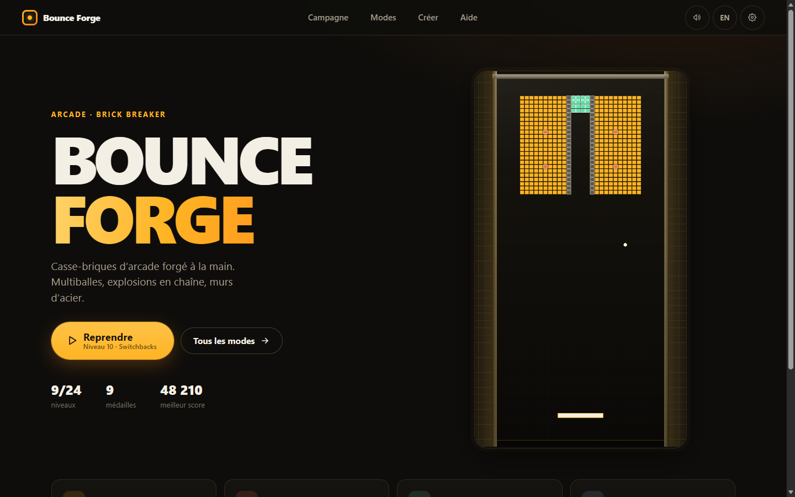
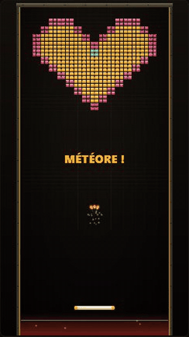
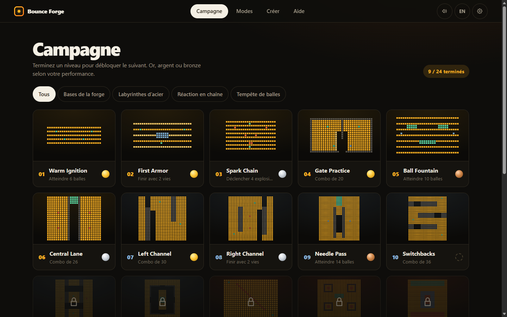
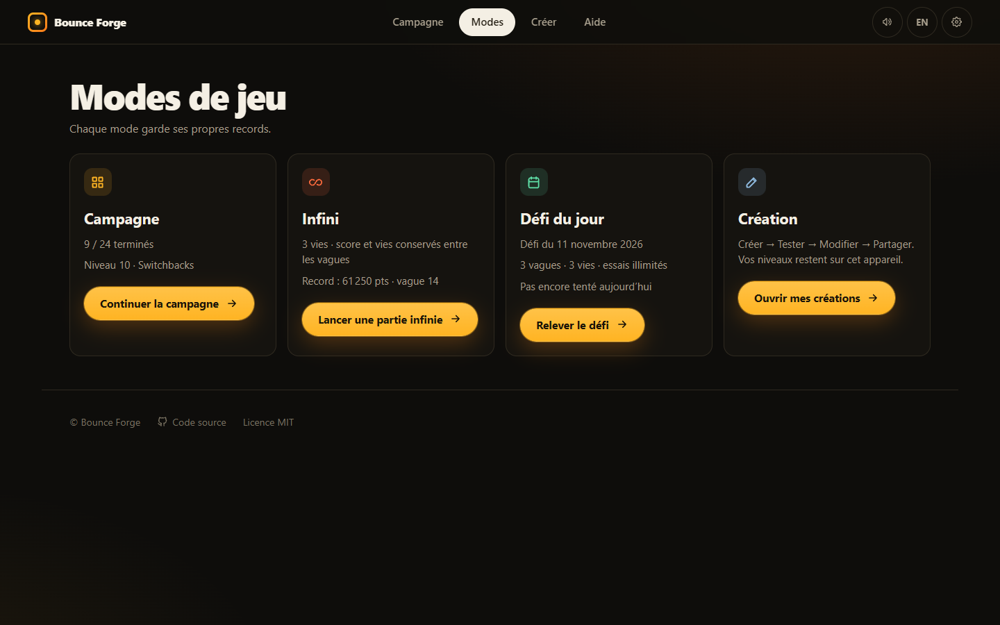
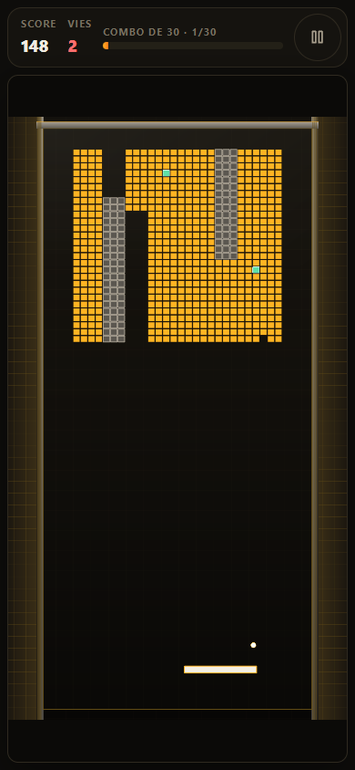

<p align="center">
  
</p>

<h1 align="center">Bounce Forge</h1>

<p align="center">
  <strong>Casse-briques d’arcade forgé à la main.</strong><br />
  Multiballes, explosions en chaîne, murs d’acier — sur ordinateur comme sur mobile.
</p>

<p align="center">
  <a href="https://matteo12sa.github.io/bounce-forge/"><strong>▶ Jouer maintenant</strong></a>
  ·
  <a href="README.en.md">English</a>
  ·
  <a href="CHANGELOG.md">Nouveautés</a>
</p>

<p align="center">
  <a href="https://github.com/MATTEO12SA/bounce-forge/actions/workflows/deploy-pages.yml"></a>
  <a href="LICENSE"></a>
</p>

<p align="center">
  
</p>

## Le jeu

Bounce Forge est un casse-briques original qui se joue directement dans le navigateur, sans
installation ni compte. Une balle devient trois, puis dix, puis quarante : chaque niveau mise sur
une idée — viser juste, déclencher des réactions en chaîne ou noyer le terrain sous les balles.

| Campagne                                                                       | Modes                                                                                |
| ------------------------------------------------------------------------------ | ------------------------------------------------------------------------------------ |
|  |  |

## Fonctionnalités

- **Campagne de 24 niveaux** en 4 chapitres — Bases de la forge, Labyrinthes d’acier, Réaction en
  chaîne, Tempête de balles — avec une médaille d’or, d’argent ou de bronze à décrocher.
- **Mode Infini** : des vagues sans fin, trois vies, score et vies conservés d’une vague à l’autre.
  La difficulté plafonne au dernier palier de la campagne.
- **Défi du jour** : trois vagues identiques pour tous les joueurs, tirées de la date UTC.
  Essais illimités, meilleur score conservé.
- **Éditeur de niveaux** : dessinez, testez, modifiez, puis partagez votre niveau avec un code
  `BF2:` (accents et emoji compris).
- **Six types de briques** reconnaissables par leur couleur _et_ leur contour : standard,
  renforcée, explosive, bonus, bouclier, acier indestructible.
- **Pensé pour tous les écrans** : HUD latéral sur ordinateur, HUD compact et commandes tactiles
  sur mobile, cibles d’au moins 44 px.
- **Accessible** : navigation au clavier, focus visible, option « Réduire les animations »,
  français et anglais.
- **Sauvegarde locale** de la progression, des médailles, des records et des créations (aucune
  donnée envoyée ailleurs).

## Commandes

| Action               | Ordinateur                   | Mobile           |
| -------------------- | ---------------------------- | ---------------- |
| Déplacer la raquette | Souris, `←` `→` ou `A` `D`   | Glisser le doigt |
| Lancer la balle      | Clic, `Espace` ou `Entrée`   | Toucher l’écran  |
| Pause                | `Échap`, `P` ou bouton pause | Bouton pause     |
| Recommencer          | `R`                          | Menu pause       |

<p align="center">
  
</p>

## Démarrage rapide

Il faut [Node.js](https://nodejs.org/) 20 ou plus récent (la CI utilise Node 24).

```bash
git clone https://github.com/MATTEO12SA/bounce-forge.git
cd bounce-forge
npm ci
npm run dev
```

Le jeu s’ouvre sur <http://localhost:5173>. `npm run dev` lance aussi le petit serveur
d’administration local qui permet de retoucher les niveaux officiels (voir
[SECURITY.md](SECURITY.md)). Pour le jeu seul : `npm run dev:vite`.

| Commande                         | Rôle                                                                |
| -------------------------------- | ------------------------------------------------------------------- |
| `npm run lint`                   | ESLint                                                              |
| `npm test`                       | Tests unitaires (Vitest)                                            |
| `npm run build`                  | Vérification TypeScript et build de production dans `dist/`         |
| `npm run test:smoke`             | Parcours complet dans un vrai navigateur sans écran (après `build`) |
| `node scripts/capture-media.mjs` | Régénère les captures et l’animation de ce README                   |

## Architecture en bref

```
src/
├── main.ts            Point d’entrée : monte l’interface HTML
├── ui/                Interface HTML/CSS (accueil, menus, HUD, pause, résultats, i18n)
└── game/
    ├── bridge.ts      Contrat typé entre l’interface et le moteur
    ├── GameApp.ts     Contrôleur Phaser, chargé à la demande
    ├── scenes/        GameScene (partie), éditeur, outils admin locaux
    ├── modes/         Générateur de vagues Infini / Défi du jour
    ├── levels/        Motifs, fabrique de niveaux, codes de partage
    └── systems/       Sauvegarde, score, bonus, collisions, audio…
```

L’interface (≈ 30 Ko compressés) s’affiche immédiatement ; Phaser n’est téléchargé qu’ensuite
pour animer l’aperçu et lancer les parties. Plus de détails dans
[docs/ARCHITECTURE.md](docs/ARCHITECTURE.md) et [docs/GAME_DESIGN.md](docs/GAME_DESIGN.md).

## Contribuer

Les idées, rapports de bug et niveaux sont les bienvenus : lisez
[CONTRIBUTING.md](CONTRIBUTING.md), puis ouvrez une
[issue](https://github.com/MATTEO12SA/bounce-forge/issues/new/choose).

## Crédits et licence

Code sous licence [MIT](LICENSE). Bibliothèques et ressources tierces listées dans
[CREDITS.md](CREDITS.md).
